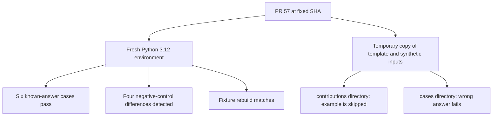

# PR 57 reproducibility review

## TL;DR

All three documented checks passed on this Mac. The kit matched all six expected answers. The negative control failed all four declared discriminating cases. Fixture regeneration matched.

One contribution-path gap is reproducible. The template directs contributors to `test-kit/contributions/`. The runner does not discover examples there. An intentionally wrong answer stays unchecked there. The same example fails comparison under `test-kit/cases/`.

Tamer approved the substantive review comment. It is [submitted upstream](https://github.com/aaif/wg-observability-and-traceability/pull/57#issuecomment-6393830488). Maintainer acceptance is not established. No upstream patch, fork, or PR was needed.

## Fixed sources

- Account: `telnemri`. Verified with `gh auth status`, `gh api user`, and the GitHub connector. GitHub user ID: `48165554`.
- [Upstream main](https://github.com/aaif/wg-observability-and-traceability/tree/f10288d27f769a4ff90184490100a0f7fdbc4d4e): `f10288d27f769a4ff90184490100a0f7fdbc4d4e`.
- [Tested PR head](https://github.com/aaif/wg-observability-and-traceability/tree/25a47f6f9deeed4a6f6d43b6d8393205d0bc494f): `25a47f6f9deeed4a6f6d43b6d8393205d0bc494f`.
- [Coordination comment](https://github.com/aaif/wg-observability-and-traceability/pull/57#issuecomment-6393683511). This was posted before substantial work. The approved substantive review is linked above.
- [Scope research](scope-research.md) records task dependencies, existing work, and policy checks.

The isolated checkout is `upstream/` in the task workspace. Its local branch is `review/pr57`. Tracked content was clean before and after validation. Every recorded kit input retained its SHA-256 hash.

## What the result establishes



A green command can leave a contributed example unchecked. This observation concerns discovery. It does not establish that all contributions should run automatically. The intended run path needs clarification from the kit author.

## Environment and setup

Test date: 2026-10-25 UTC. Host: macOS 26.6.2, arm64. Interpreter: Python 3.12.13. The workflow declares Python 3.12 on Ubuntu. This run matches the interpreter family; it does not reproduce the hosted operating system.

The virtual environment contained `cryptography==50.0.1`, `cffi==2.1.1`, and `pycparser==3.12`. See [installation output](install.log) and [raw results](results.json).

Commands from the task workspace:

```sh
git clone https://github.com/aaif/wg-observability-and-traceability.git upstream
git -C upstream fetch origin pull/57/head:review/pr57
git -C upstream checkout review/pr57
git -C upstream rev-parse HEAD
python3.12 -m venv .venv-pr57
.venv-pr57/bin/python -m pip install -r upstream/test-kit/requirements.txt
python3 aaif-contributions/evidence/pr57/reproduce.py \
  --checkout upstream \
  --python .venv-pr57/bin/python \
  --output aaif-contributions/evidence/pr57/results.json
```

The reproduction script refuses a different HEAD. For a later rerun, check out the tested SHA if the PR has moved. The script runs the following commands from the upstream root with the virtual environment's Python executable:

```sh
python test-kit/run.py
python test-kit/run.py --reader naive --expect-fail
python test-kit/generate.py --check
```

`python` above means `.venv-pr57/bin/python` by absolute path. The script records each exact invocation.

## Validation results

| Check | Actual result | Status |
| --- | --- | --- |
| Pinned dependency installation | Exit 0. All three resolved packages installed. | Passed |
| Reference reader | Exit 0. Six of six expected answers match. | Passed |
| Naive reader with `--expect-fail` | Exit 0. Four required differences. Two other cases match. | Passed negative control |
| Fixture regeneration | Exit 0. Recorded fixtures match a rebuild. | Passed |
| Probe under `contributions/` | Exit 0. Six cases reported. Probe absent. | Discovery gap confirmed |
| Same probe under `cases/` | Exit 1. Seven cases reported. `DIFF review-probe`. | Expected diagnostic failure |
| Source preservation | Empty tracked status. All input hashes unchanged. | Passed |
| Runtime/provider integrations | No provider or agent runtime executed. | Unrun |
| Full relationship conformance | Only the shipped six cases ran. | Unrun |
| Hosted upstream CI | Run 40024856073 has `action_required`. | External action needed |

No baseline validation command failed. The probe's exit 1 is deliberate. It shows that the same mismatching example is checked when it is in the runner's discovery directory.

The raw results contain a pip cache warning during `pip freeze`. That command exited zero. It did not change dependency resolution or test results.

## Contribution-discovery diagnostic

The script uses a temporary copy. It copies `TEMPLATE` to `contributions/review-probe`. It adds the existing changed-ticket records and basis. It writes an intentionally incorrect expected answer. These are diagnostic inputs, not a new runtime export.

The first run reports only the original six cases. The script then moves the same probe into `cases/review-probe`. The next run reports seven cases and rejects the wrong answer.

Source references at the tested SHA:

- [Template destination](https://github.com/aaif/wg-observability-and-traceability/blob/25a47f6f9deeed4a6f6d43b6d8393205d0bc494f/test-kit/TEMPLATE/mapping.md#L3).
- [Runner discovery and comparison](https://github.com/aaif/wg-observability-and-traceability/blob/25a47f6f9deeed4a6f6d43b6d8393205d0bc494f/test-kit/run.py#L149).
- [Reproduction script](reproduce.py) and [raw command output](results.json).

A focused next step is to document the intended contribution run path. The author can choose whether examples belong under `cases/` or need a separate run command. This review does not select new runner semantics.

## Limits and policy

This is a fresh execution by an external contributor, using the kit's own reader. It is not an independently implemented reader. Expected outcomes were already visible in the README and prior discussion. This was not answer-blind evaluation.

The six cases are synthetic. Signature verification uses the supplied synthetic key. It does not authenticate tenant metadata or prove a real target effect. These results do not close Task 7 or Task 8.

[Upstream CI run](https://github.com/aaif/wg-observability-and-traceability/actions/runs/40024856073) is separate from this local run. A maintainer must handle its required action. This review does not request or perform a workflow approval.

The charter requires applicable DCO/CLA compliance. No exact personal attestation step was found. No attestation was made for Tamer. The September 30 minutes emphasize human participation. Tamer reviewed and approved the substantive comment before posting. The packet discloses Codex AI assistance.

## Tamer's review checklist

- [x] Read [the proposed upstream comment](proposed-upstream-comment.md).
- [x] Check that the contribution-path observation is clear.
- [x] Check the three passed checks and the deliberate diagnostic failure.
- [x] Confirm that the synthetic-data limits are clear.
- [x] Decide whether to post this comment on PR 57.

Tamer approved posting. The head and relevant discussion were unchanged at the publication recheck. No rerun was needed. The [published comment](https://github.com/aaif/wg-observability-and-traceability/pull/57#issuecomment-6393830488) has an immutable evidence link. Its author and exact body were verified after posting. See [submission details](submission.json). Maintainer acceptance remains pending.

Prepared with Codex AI assistance. Short sentences and consistent terms follow the requested ASD-STE100-style approach. No certified compliance is claimed.

## Independent review

The fixed review baseline was `1ba5e574d8e7237192bd2baaf60e6cd3e9731d92`. The reviewed implementation commit was `c7ad56bd03cf8064f9f91a2eef3ee76ba8713fd9`.

Standards review found no material violation. Spec review found no missing behavior or scope creep. Both requested a pinned evidence link in the final comment. Standards review also requested a clearer discovery anchor. Both items are corrected. The Spec reviewer independently reran the reproduction script and confirmed the same command outputs and exit codes. See [the review record](REVIEW.md).
